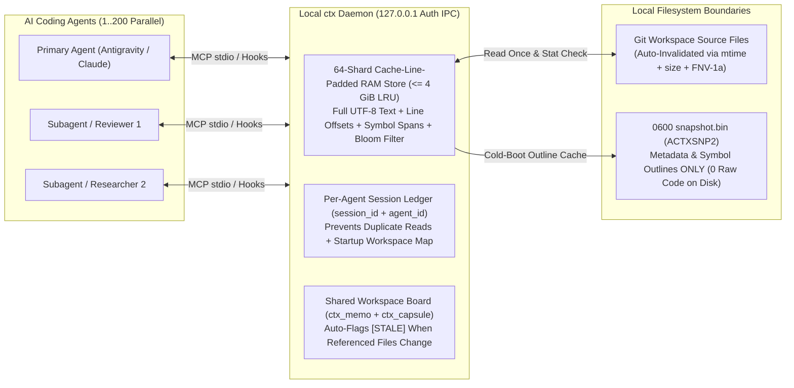

# `ctx-mcp` — In-RAM Codebase Context Broker & MCP Server for AI Agents

[](https://github.com/be0hhh/ctx-mcp/actions/workflows/ci.yml)
[](https://github.com/be0hhh/ctx-mcp/releases/latest)
[](#license)


`ctx-mcp` (`ctx`) is a fast, single-binary **in-RAM Context Broker and Model Context Protocol (MCP) server** written in pure Rust (`0` external crates). Instead of letting every AI coding agent blindly scan your repository from scratch on every prompt, `ctx-mcp` keeps a live, auto-invalidated index of your codebase in memory and answers multi-file navigation, symbol, and read queries in **one compact round-trip**.

> [!IMPORTANT]
> **Current Validation Status — Battle-Tested on Google Antigravity:**
> - **Google Antigravity (Gemini):** **Thoroughly benchmarked and proven.** In end-to-end 5-agent parallel waves, `ctx-mcp` cuts **parallel wave time by `-51.8%`**, **mean task time by `-44.7%`**, **tool round-trips by `-64.3%`**, and **new (uncached) input tokens by `-38.5%`** while maintaining `100%` (`20/20`) `file:line` accuracy ([see full comparison table below](#1-google-antigravity--gemini-4-carbon-low-5-parallel-tasks)).
> - **Claude Code:** Eager MCP and lifecycle hooks are fully supported; extended live-model benchmark runs are currently being collected.
> - **Codex CLI (`GPT / Sol`):** Reported transparently below. Although `ctx` search itself runs in `1.23 ms`, Codex CLI's deferred MCP `tool_search` wrapper adds an extra API turn (`~19k` cached tokens) on short tasks, so **Codex CLI is unchecked `[ ]` by default** during setup.

---

## What Problem Does `ctx-mcp` Solve?

When an AI agent works on a medium or large codebase using standard shell/file tools, **most of its latency and token budget goes into blind discovery**:

| Without `ctx-mcp` (Raw `rg` / `find` / `read`) | With `ctx-mcp` (Shared In-RAM Broker) |
|---|---|
| Every agent starts cold and runs **3–6 sequential** `find`, `rg`, `head`, and `sed` calls just to locate files and functions. | One lightweight background daemon keeps the workspace map, file bytes, `#include`s, and `[L_start..L_end]` symbol boundaries **warm in RAM**. |
| Agents waste turns guessing paths (`.hpp` vs `.cpp` vs nested directories) and hit **800-line file-read truncations**, paging through files in chunks. | Bare module stems (`"OrderTable:place"`) automatically resolve to `.hpp` + `.cpp`, and up to **4 searches or full `1 MiB` files** return in **1 call**. |
| Raw `rg` output repeats long file paths on every line and floods the context window with header comment blocks instead of implementation code. | Adaptive output groups matches by file with `@symbolName` subheaders and enforces a **code-first per-file quota** so comments never starve real code. |
| When 5–20 subagents run in parallel, every subagent re-reads the same files from disk and repeats the same grep discovery from scratch. | **All concurrent agents share one RAM cache** (`12,500+ ops/sec`), exchange verified findings via `ctx_memo`, and track per-agent read state independently. |

---

## One-Command Install (Prebuilt Static Binaries — No Rust Required)

Paste **one command** in your terminal. It downloads the **prebuilt, SHA-256-verified binary** from [GitHub Releases](https://github.com/be0hhh/ctx-mcp/releases/latest) (100% static `musl` on Linux — works on any distro without `glibc` version issues; native binaries on macOS ARM64/x86_64 and Windows x86_64) and opens an interactive harness selector:

### Linux / macOS / WSL2
```bash
curl -fsSL https://raw.githubusercontent.com/be0hhh/ctx-mcp/main/setup/install.sh | bash
```

### Windows (PowerShell)
```powershell
irm https://raw.githubusercontent.com/be0hhh/ctx-mcp/main/setup/install.ps1 | iex
```

### Node / `npx` (Cross-Platform)
```bash
npx github:be0hhh/ctx-mcp
```

### Interactive Setup Menu
`ctx setup` detects which AI harnesses are present on your machine and pre-selects the recommended targets:

```text
Downloaded prebuilt ctx-linux-x86_64 from GitHub Releases (SHA-256 verified).

  ctx-mcp setup — select AI harnesses to configure:
    [x] 1. Antigravity (Gemini)   [detected]   * Recommended (-45% time, -38% new tokens)
    [x] 2. Claude Code            [detected]   * Recommended
    [ ] 3. Codex CLI (GPT/Sol)    [detected]   (off by default: deferred MCP token overhead)

  Press Enter to confirm, type 1/2/3 to toggle (or 'all' / 'none' / 'q' to cancel):
```

- **Non-interactive / CI setup:**
  ```bash
  curl -fsSL https://raw.githubusercontent.com/be0hhh/ctx-mcp/main/setup/install.sh | bash -s -- --targets antigravity,claude
  ```
- **Force compile from source** (optional, requires `rustc`): pass `--from-source`
- **Re-configure harnesses anytime:** `ctx setup`
- **Verify daemon IPC, snapshot & config health:** `ctx doctor`

### Clean Uninstall
Stops the background daemon, removes only `agent_ctx` MCP & hook entries (preserving your other MCP servers, hooks, and `.bak` backups), and deletes `~/.local/bin/ctx`:

```bash
ctx uninstall
```

- Detach from a single harness only (e.g., disable Codex while keeping Antigravity & Claude): `ctx uninstall --targets codex`
- Terminal one-liners if `~/.local/bin` is not in `PATH`:
  - **Linux / macOS / WSL2:** `curl -fsSL https://raw.githubusercontent.com/be0hhh/ctx-mcp/main/setup/uninstall.sh | bash`
  - **Windows (PowerShell):** `irm https://raw.githubusercontent.com/be0hhh/ctx-mcp/main/setup/uninstall.ps1 | iex`

---

## How Context Lives in RAM: Where Data Goes & How It Stays Fresh



1. **Auto-Starting Local RAM Daemon:** On the very first MCP call or CLI command, `ctx` transparently spawns a single per-user background daemon bound to `127.0.0.1` with a `0600`-protected auth token (`daemon.json`) and pre-indexes workspace file stems in the background during MCP `initialize`.
2. **Instant Edit Freshness (Never Serves Stale Code):** Every cached file stores its `(mtime, byte_size, 64-bit FNV-1a content hash)`. Whenever you or an agent edits a file, `ctx` detects the change immediately, refreshes that file's line table and symbol spans in RAM, and evicts oldest entries cleanly if memory reaches the `4 GiB` LRU ceiling.
3. **Per-Agent Read Deduplication:** Lifecycle hooks (`agent-context` / `PreToolUse` / `PostToolUse`) inject a compact `[RAM-Ctx Startup]` map of the workspace and remember which files **each individual agent** has already read so an agent does not waste tokens re-reading unchanged files.
4. **Zero Raw Source Code Written to Disk:** To survive reboots with near-zero warmup, `ctx` writes a `0600` binary snapshot (`ACTXSNP2`) containing **only file metadata and structural symbol outlines** — raw source text lives strictly in volatile RAM and is never persisted to disk. Secret files (`.env*`, `*.pem`, `*.key`, credentials) and symlinks escaping the workspace root fail closed with `REFUSED`.

---

## Why `ctx-mcp` Shines in Multi-Agent Orchestration

Single-agent tasks already benefit from fewer turns, but **`ctx-mcp` becomes a force multiplier when orchestrating subagents, review pairs, or parallel agent swarms**:

- **Cuts Parallel Wave Tail-Latency in Half (`42.2s -> 20.4s`):** In a parallel wave of 5 subagents, the entire wave waits for the **slowest** agent to finish. With raw `rg`, one agent hitting 4–5 sequential grep/read turns stalls the whole pipeline. Collapsing multi-file lookup into **1 batched `q` call** cuts 5-agent wave completion time by **`-51.8%`**.
- **One Shared Warm RAM Index Across 10–200 Agents:** The first agent to inspect a subsystem warms its files and parsed C++/Rust/Python/TS symbol spans in RAM. Subsequent reviewers, planners, and test authors hit hot memory in **`0.5–5 ms`** (`12,551 ops/sec` at 200 concurrent agents, backed by 64 `CachePadded` 64-byte-aligned shards with zero lock contention).
- **Isolated Sibling Read Histories (`session_id + agent_id`):** Subagents spawned under a shared parent session get **isolated read ledgers** — Agent B is never blocked from reading a file just because Agent A read it earlier, while each agent is still protected from re-reading files already in its own context.
- **Shared Findings Board (`ctx_memo`) with Automatic `[STALE]` Detection:** A researcher agent can publish architectural invariants or symbol maps to `ctx_memo` once; downstream workers read that summary instead of re-auditing 30 files. If any worker modifies one of the referenced files, `ctx` compares FNV-1a hashes and automatically marks the memo `[STALE]`.
- **Verified Task Handoffs (`ctx_capsule`):** Orchestrators prepare compact, host-verified assignment capsules for subagents without pasting giant file dumps into every subagent prompt.

---

## Key Advantages at a Glance

- **Zero External Dependencies (`Cargo.toml` = `0` crates):** Pure Rust `std`, ~1.1 MiB stripped LTO binary, runtime `AVX2` SIMD line/literal scanning with portable scalar fallback, zero `f32`/`f64` floats, and cache-line-aligned internals.
- **Ergonomic `q` Batching (`1–4` Queries in 1 Call):** Short string syntax (`"ModuleOrDir:pattern"`) minimizes LLM output tokens, handles C++ `:::` global symbols safely, and auto-expands bare stems (`"PositionTable"`) to both `.hpp` and `.cpp`.
- **Signal-Dense Grouped Output:** Prints each file path once, adds `@enclosingSymbol` subheaders, and uses zero-division round-robin slot balancing so doc comments in `.hpp` files never crowd out `.cpp` logic.
- **No 800-Line Truncation Tax:** `ctx_read` serves full files or exact `path:start-end` slices up to `1 MiB` in a single call, and `ctx_symbols` extracts exact struct/function bodies (`compact=true` previews + continuation slice).

### Example Batched `ctx_search` Call & Output
```json
{
  "q": [
    "PositionTable:applyfill",
    "StartupStreamBoundary:userdata|subscrib",
    "AccountObservationExtractor:::fetchStartupSnapshotCold"
  ]
}
```
```text
src/src/Runtime/Hot/Position/PositionTable.hpp
  @canApplyFillHot
  145: [[nodiscard]] CXET_ALWAYS_INLINE bool canApplyFillHot(
  @applyFillHot
  168: [[nodiscard]] CXET_ALWAYS_INLINE bool applyFillHot(
  179: if (bytescan::hftUnlikely(!states_[instId].applyFillHot(
```

---

## Benchmarks: Direct (`rg`) vs `ctx-mcp`

Measured on a ~1,800-file C++26 & Python repository across **5 independent 4-anchor navigation tasks** (`20` ground-truth `file:line` targets per wave, executed in 5-way parallel waves; raw data and reproducible runner in [`benchmarks/`](benchmarks/)).

### 1. Google Antigravity — `Gemini 4 Carbon (Low)` (5 Parallel Tasks — Primary Validated Target)

| Metric | Direct (`rg`) | `ctx-mcp` | Delta (abs.) | Delta (%) |
|---|---:|---:|---:|---:|
| Ground-truth `file:line` accuracy | `20 / 20` (`100%`) | `20 / 20` (`100%`) | `0` | `0.0%` |
| **5-task parallel wave wall-clock, s** | `42.22` | `20.35` | `-21.87` | **`-51.8%`** |
| **Task duration (mean), s** | `31.40` | `17.35` | `-14.05` | **`-44.7%`** |
| Task duration (median), s | `33.40` | `17.02` | `-16.38` | **`-49.0%`** |
| Task duration (sum across 5 tasks), s | `156.99` | `86.77` | `-70.22` | **`-44.7%`** |
| **Tool calls (mean / sum)** | `2.80` (`14`) | `1.00` (`5`) | `-1.80` (`-9`) | **`-64.3%`** |
| Tool execution time (mean), ms | `2,512.93` | `979.93` | `-1,533.00` | **`-61.0%`** |
| Tool output payload (sum), bytes | `11,443` | `7,513` | `-3,930` | **`-34.3%`** |
| **Uncached (new) input tokens (sum)** | `122,134` | `75,152` | `-46,982` | **`-38.5%`** |
| Cached input tokens (sum) | `164,015` | `122,395` | `-41,620` | **`-25.4%`** |
| Total input tokens (sum) | `286,149` | `197,547` | `-88,602` | **`-31.0%`** |
| Output tokens (sum) | `2,776` | `2,139` | `-637` | **`-22.9%`** |
| **Total tokens (sum across 5 tasks)** | `288,925` | `199,686` | `-89,239` | **`-30.9%`** |

### 2. Codex CLI — `GPT-6.2 Sol (Low)` (5 Parallel Tasks — Honest Baseline)

| Metric | Direct (`rg`) | `ctx-mcp` | Delta (abs.) | Delta (%) |
|---|---:|---:|---:|---:|
| Ground-truth `file:line` accuracy | `20 / 20` (`100%`) | `20 / 20` (`100%`) | `0` | `0.0%` |
| 5-task parallel wave wall-clock, s | `17.77` | `16.88` | `-0.89` | **`-5.0%`** |
| Task duration (mean / median), s | `16.20` / `16.32` | `15.28` / `15.14` | `-0.92` / `-1.18` | **`-5.7%` / `-7.2%`** |
| Tool calls (mean / sum) | `1.40` (`7`) | `1.00` (`5`) | `-0.40` (`-2`) | **`-28.6%`** |
| Median `ctx` search wire latency, ms | — *(shell)* | **`1.23`** | — | — |
| Tool output payload (sum), bytes | `11,058` | `6,425` | `-4,633` | **`-41.9%`** |
| Uncached (new) input tokens (sum) | `90,485` | `92,774` | `+2,289` | `+2.5%` |
| Cached input tokens (sum)\* | `288,256` | `385,664` | `+97,408` | `+33.8%` |
| Output tokens (sum) | `1,213` | `1,545` | `+332` | `+27.4%` |
| **Total tokens (sum across 5 tasks)**\* | `379,961` | `479,983` | `+100,022` | `+26.3%` |

*\*Codex CLI wraps external MCP servers behind a deferred `tool_search` step (`3` API turns instead of `2` on 1-call tasks), adding ~19k cached tokens per task compared to raw shell-only `codex exec` with zero MCP servers. Because of this client-side overhead, Codex CLI is disabled by default in `ctx setup`.*

### 3. Shared Daemon Multi-Agent Load (`ctx bench --agents 1,10,50,100,200 --ops 25`)

| Concurrent Agents | Total Ops | Throughput (`ops/sec`) | `p50` | `p95` | `p99` | Isolation / RPC Errors |
|---:|---:|---:|---:|---:|---:|---:|
| `1` | `25` | `1,780` | `0.49 ms` | `0.61 ms` | `0.79 ms` | `0` |
| `10` | `250` | `8,602` | `0.89 ms` | `2.07 ms` | `3.78 ms` | `0` |
| `50` | `1,250` | `10,343` | `2.88 ms` | `14.18 ms` | `27.51 ms` | `0` |
| `100` | `2,500` | `10,555` | `5.51 ms` | `20.62 ms` | `44.43 ms` | `0` |
| `200` | `5,000` | `12,551` | `8.30 ms` | `50.15 ms` | `93.13 ms` | `0` |

---

## MCP Tools & CLI Reference

| MCP Tool | CLI Equivalent | Purpose |
|---|---|---|
| `ctx_search` | `ctx search -q "Mod:pat"` | Parallel AVX2/ripgrep search (`1–4` queries in `q`, `8 KiB` cap, smart-case, bare-stem `.hpp`+`.cpp`) |
| `ctx_inspect` | `ctx inspect <dir...>` | Batch directory triage (`<=80` files, exact line counts, `[OVER 800L]`, `#include`, symbol spans) |
| `ctx_symbols` | `ctx sym <Mod#Sym> --compact` | Exact symbol body extraction (`compact=true`: `<=24` lines + continuation slice) |
| `ctx_read` | `ctx read <path[:s-e]>` | Full-file or line-range read from RAM up to `1 MiB` (no 800-line truncation) |
| `ctx_outline` | `ctx outline <path...>` | Structural `[L_start-L_end]` symbol spans across files/directories |
| `ctx_memo` | `ctx memo <put\|get\|list>` | Shared workspace findings board with automatic `[STALE]` FNV-1a tracking |
| `ctx_capsule` | `ctx capsule <prepare\|claim>` | Host-verified subagent task capsule handoff |
| `ctx_elf_audit` | `ctx elf --elf <bin>` | Optional static ELF64 section/symbol audit |

## License

Licensed under either of [Apache License, Version 2.0](LICENSE-APACHE) or [MIT License](LICENSE-MIT) at your option.
